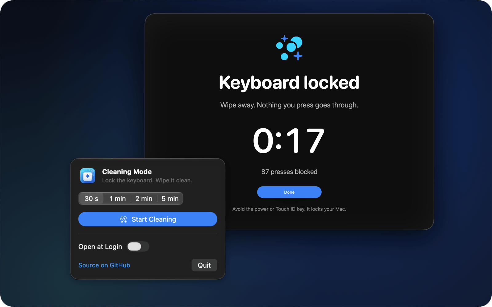

# Cleaning Mode

**Lock your keyboard. Wipe it clean.**

Cleaning Mode is a small macOS menu bar app with one job. Click it, and every key on your
keyboard stops working for the time you pick. Wipe the keys, then click Done. No junk text,
no shortcuts, no volume or brightness jumps. Free and open source (MIT).



[Website](https://cleaning.mulualem.com) · [Download](https://github.com/MULUALEM-TEKLE/cleaning-mode/releases/latest)

## Use it

1. Click the keyboard icon in the menu bar.
2. Pick 30 s, 1 min, 2 min or 5 min. Click **Start Cleaning**.
3. Wipe. A dark cover shows a countdown and how many presses it blocked.
4. Click **Done**, or let the timer run out. Your keyboard works again.

The mouse and the trackpad keep working the whole time.

## Install

Requires macOS 14 Sonoma or later. Apple silicon and Intel.

1. Download `Cleaning-Mode.zip` from the [latest release](https://github.com/MULUALEM-TEKLE/cleaning-mode/releases/latest).
2. Unzip it and move **Cleaning Mode** to your Applications folder.
3. Open it. macOS blocks the first launch, because the app is not notarized yet
   (that needs a paid Apple Developer ID). Open **System Settings › Privacy & Security**,
   scroll down, and click **Open Anyway**.
4. Click **Allow Access…** in the popover and turn on Cleaning Mode under
   **Privacy & Security › Accessibility**. macOS requires this permission for any app
   that stops key presses.

Each new version has a new ad hoc signature, so macOS can ask for Accessibility access
again after an update. If the lock does not start, turn Cleaning Mode off and on again
in the Accessibility list.

Or build it yourself (below).

## What it blocks

| Blocked | Not blocked |
| --- | --- |
| All letter, number and symbol keys | The power / Touch ID key. It locks your Mac, so do not press it while you wipe. |
| Modifiers: ⌘ ⌥ ⌃ ⇧, Fn / Globe, Caps Lock | Mouse and trackpad |
| The function row | |
| Media keys: volume, brightness, play, keyboard backlight | |

## Safe by design

- The timer always ends the lock. The longest choice is 5 minutes.
- The block lives inside the app. If the app quits or crashes, your keyboard works again at once.
- If macOS turns the block off because the system is busy, the app turns it on again.
- Caps Lock can toggle below the block while you wipe. When the lock ends, the app sets Caps Lock back to how it was.

## Privacy

Cleaning Mode does not record or store what you press. It only counts presses, in memory,
to show the number on the cover. It makes no network connections and has no analytics.
The only setting it saves is the lock duration.

## How it works

The app adds a Quartz event tap (`CGEvent.tapCreate`) at the head of the session event
stream. While the lock is on, the tap drops key down, key up, modifier and media key
(`NX_SYSDEFINED`, subtype 8) events. Mouse events pass through. The code is in
[`KeyboardLock.swift`](cleaning-mode/KeyboardLock.swift); the cover is in
[`Overlay.swift`](cleaning-mode/Overlay.swift).

An event tap that can drop events needs the Accessibility permission, and it does not work
inside the App Sandbox. That is why the app is not on the Mac App Store.

## Build from source

Requires Xcode 26 or later.

```sh
git clone https://github.com/MULUALEM-TEKLE/cleaning-mode.git
cd cleaning-mode
xcodebuild -project cleaning-mode.xcodeproj -scheme cleaning-mode test      # run the tests
./scripts/release.sh                                                       # universal build in dist/
```

Or open `cleaning-mode.xcodeproj` and run the `cleaning-mode` scheme.

The app icon is drawn in code: `swift Design/IconGen.swift 1024 icon.png`.

## Contributing

Bug reports and pull requests are welcome. Please keep the app small: it does one thing.

## License

MIT. See [LICENSE](LICENSE).
